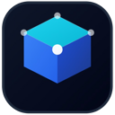
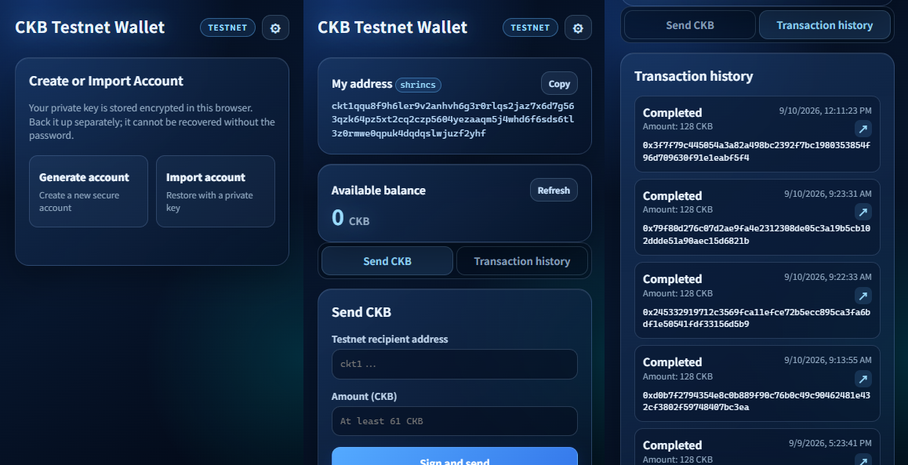

# CKB Testnet Wallet



A testnet web wallet extension for the CKB blockchain.



# Nervos DAO

The wallet supports DAO deposits, withdrawal preparation, and withdrawals after the
claim epoch. DAO cells are queried by the wallet's exact lock and DAO type scripts;
their deposit and withdrawal headers are fetched only when an individual cell is
used, avoiding per-cell transaction-history scans while listing holdings.
Successful DAO transactions are recorded alongside transfers in transaction history.

# Install (Source Code)

```bash
$ git clone https://github.com/mohanson/ckb-web-wallet.git
```

In Chrome, enable **Developer Mode** by toggling the switch in the top right corner of the `chrome://extensions/` page. Click the "Load unpacked" button in the top left corner and select the `ckb-web-wallet/dist` folder where you cloned the repository.

# Install (Chrome Web Store)

See it on the [Chrome Web Store](https://chromewebstore.google.com/detail/ckb-testnet-wallet-beta/nghimcjehoahofjcapbgcgfbbebobdgb).

# Test account

The test network includes some accounts with funds available for your testing.

| Account Type |                                         Private Key / Seed                                         |
| ------------ | -------------------------------------------------------------------------------------------------- |
| secp256k1    | 0x0000000000000000000000000000000000000000000000000000000000000001                                 |
| secp256k1    | 0x0000000000000000000000000000000000000000000000000000000000000002                                 |
| shrincs      | 0x000000000000000000000000000000000000000000000000000000000000000000000000000000000000000000000001 |

# License

MIT.
